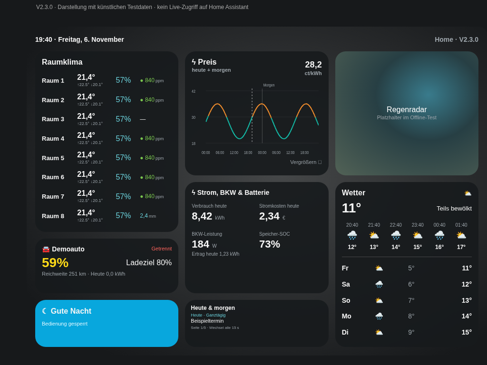

# Home Dashboard iPad · V2.1.0

Eine konfigurierbare Home-Assistant-Karte für ein übersichtliches Dashboard im Querformat. **Der öffentliche Code enthält keine Zuordnungen zu einer konkreten HA-Installation.** Entitäten werden im eigenen HA-Dashboard-YAML gespeichert und bleiben bei HACS-Updates erhalten.



## Funktionen

- Raumtemperatur, Luftfeuchte, CO₂ und optional Niederschlagsmenge; Temperatur-Min/Max aus der HA-Historie.
- Tibber-Preisverlauf für heute und automatisch auch morgen, sobald Preise vorhanden sind. Antippen öffnet die Großansicht mit verschiebbarem Cursor, Zeitintervall und Preis in ct/kWh.
- Weather Radar Card mit DWD, 60 Minuten Vergangenheit, 60 Minuten Vorhersage und Zoomstufe 8.
- Stunden- und Tageswetter, Fahrzeugstatus, PV-Leistung, Tagesertrag und Speicher-SOC.
- Gemeinsame Kalenderliste für heute und morgen, automatischer Seitenwechsel.
- Optionaler Aufruf eines selbst konfigurierten Gute-Nacht-Skripts; Bedienung standardmäßig gesperrt.

Entwickelt für ein 9,7-Zoll-iPad im Querformat, beispielsweise iPad der 6. Generation. Browserdarstellung mit nachgebildeter HA-Kopf-/Seitenleiste bei 1024 × 768, 960 × 700 und 1280 × 800 geprüft. Kein Nachweis eines Tests auf einem physischen iPad oder mit einer bestimmten HA-Installation.

## HACS-Installation

1. HACS → ⋮ → Benutzerdefinierte Repositories.
2. `https://github.com/CommanderReiker/Homedashboard-iPad` mit Kategorie **Dashboard** hinzufügen.
3. **Home Dashboard iPad** herunterladen.
4. Die von HACS registrierte Ressource verwenden. Falls keine vorhanden ist, genau einmal als JavaScript-Modul eintragen:

   ```text
   /hacsfiles/Homedashboard-iPad/Homedashboard-iPad.js
   ```

5. Ein eigenes Dashboard mit einer Panel-Ansicht und `type: custom:home-dashboard` anlegen. Entitäten lokal konfigurieren, siehe [Konfiguration](docs/CONFIGURATION.md). Das öffentliche [Beispiel](dashboard/dashboard.example.yaml) verwendet ausschließlich erfundene IDs.
6. Browser vollständig neu laden. Die Karte zeigt die vollständige Versionsnummer an.

Die Weather Radar Card muss separat über HACS installiert sein. Wetter-, Tibber- und Kalenderintegrationen werden nicht durch die Karte installiert. Für den Preisverlauf wird die offizielle HA-Aktion `tibber.get_prices` benötigt. Ohne passende Konfiguration werden keine Kalender-, Wetter-, Tibber- oder Temperaturhistorienabfragen ausgelöst. Zur möglichen Erweiterung um Wolken siehe [Regenradar und Wolken](docs/CONFIGURATION.md#regenradar-und-wolken). Das Radar verwendet weiterhin die im eigenen HA vorhandene Kartenposition und kontaktiert seinen Datenanbieter.

## Updates und eigene Daten

HACS aktualisiert ausschließlich die allgemeine JavaScript-Datei. Das aktive Dashboard-YAML mit eigenen Entitäten bleibt in HA. Nach einem Update den Browser einmal vollständig neu laden: Eine geöffnete Seite führt sonst weiterhin den alten Programmcode aus. Sensorwerte aktualisieren sich unabhängig davon automatisch.

Keine privaten YAML-Dateien, Tokens, Adressen oder realen Haushaltskonfigurationen in dieses öffentliche Repository einchecken oder in Issues posten. Die Demo und das Beispiel enthalten nur synthetische Zuordnungen. Eine Sicherung der eigenen Konfiguration erfolgt über die persönlichen HA-Backups, nicht über das öffentliche Repo.

## iPad sperren

Eigenen HA-Benutzer ohne Administratorrechte verwenden. Für eine vollständig berührungsgesperrte Anzeige am iPad den **geführten Zugriff** aktivieren und dort **Berührung deaktivieren**. Ein normaler HA-Benutzer oder ausgeblendete Menüs allein verhindern nicht jede Gerätesteuerung. Bei ausgeschalteter Berührung ist auch ein freigegebener Gute-Nacht-Knopf nicht bedienbar.

## Entwicklung und Prüfungen

Node.js mit eingebautem Testrunner; keine npm-Abhängigkeiten:

```sh
npm run build
npm run check
npm run check:dist
npm test
```

Quellen: `www/home-dashboard/`. Deterministisches HACS-Artefakt: `dist/Homedashboard-iPad.js`. Der Build verpackt nur allgemeinen Code, keine Dashboard-YAML. Neue Versionen benötigen dieselbe Versionsnummer in `package.json`, `VERSION` und der Importkennung sowie Releasehinweise unter `docs/releases/vX.Y.Z.md`. Der Release-Workflow baut die getaggten Quellen und veröffentlicht das einzelne JavaScript-Asset.

Optionaler Offline-Browsercheck mit Python Playwright und Chromium unter `/usr/bin/chromium`:

```sh
HACS_BUNDLE=1 python tests/browser_smoke.py
```

Ohne `HACS_BUNDLE=1` wird die Quellversion geprüft und `docs/demo.png` mit synthetischen Daten erzeugt. Geprüft werden Layout, Datenverarbeitung, Konfiguration, deaktivierte Bedienung und der optionale Skriptaufruf mit nachgebildeten HA-Antworten. Das ersetzt keinen Live-Test von HA, DWD oder iPadOS.
