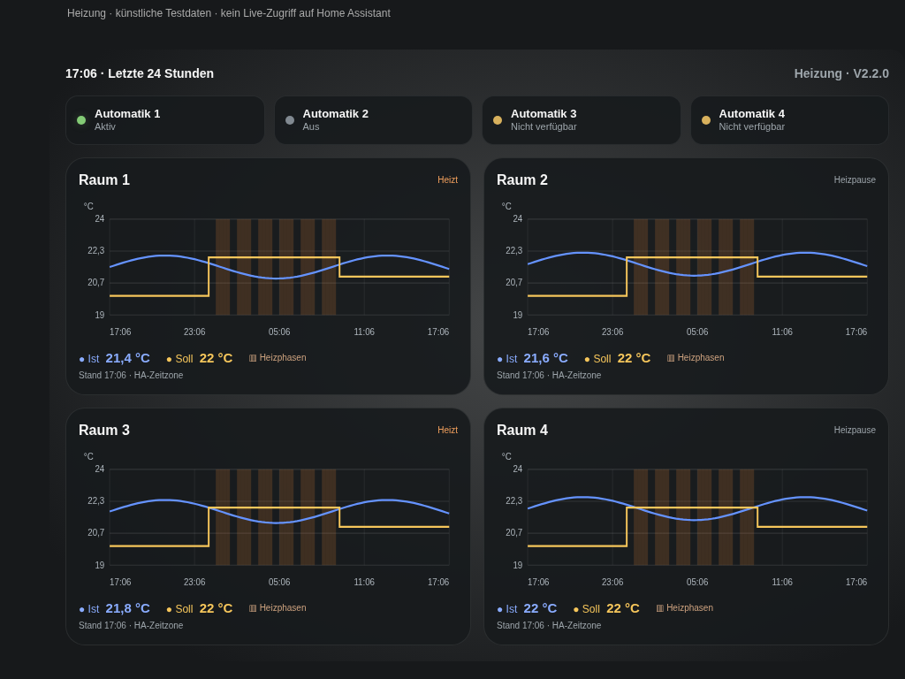

# Heizungsreiter ab V2.2.0

Die neue Ansicht ist eine reine Anzeige für vier Heizungsregler. Oben stehen vier Statusfelder der Heizungsautomatik, darunter vier flache Verlaufskacheln im 2×2-Raster. Auf schmalen Displays stehen die Regler untereinander. Die Schalter und Heizungsregler werden nicht bedient.



## Lokal hinzufügen

1. V2.2.0 oder neuer über HACS installieren und die Dashboard-Seite vollständig neu laden.
2. Das [Ansichtsbeispiel](../dashboard/heating.view.example.yaml) lokal kopieren. Alle `demo_…`-Entitäten und Raumnamen durch eigene Zuordnungen ersetzen. Keine eigene Datei ins öffentliche Repository laden.
3. Im Rohkonfigurationseditor des vorhandenen HA-Dashboards unter `views:` eine **zusätzliche** Ansicht ergänzen. Den Inhalt des Beispiels als neuen Listeneintrag mit `- title: Heizung` einsetzen; das vorhandene Zuhause-Dashboard bleibt erhalten. Das [vollständige Dashboard-Beispiel](../dashboard/dashboard.example.yaml) zeigt die Einrückung beider Ansichten.
4. Bei einem Dashboard im YAML-Modus kann die neue Ansicht stattdessen in einer privaten lokalen Datei liegen. Diese Datei im eigenen Dashboard unter `views:` mit `- !include heating.view.yaml` einbinden. `!include` funktioniert nicht im UI-Rohkonfigurationseditor eines gespeicherten Dashboards.

Die Entitäten bleiben ausschließlich in der eigenen HA-Konfiguration. HACS aktualisiert den allgemeinen Kartencode, nicht die lokalen Zuordnungen. Es gibt keine zusätzlichen Kartenabhängigkeiten für die Heizungsansicht.

## Schalter und Regler

Die Karte verwendet `type: custom:home-dashboard` und `view: heating`. Ohne `view` bleibt die bisherige Zuhause-Ansicht aktiv.

Unter `heating.switches` stehen bis zu vier Objekte mit `name` und `entity`. Geeignet sind `switch`-, `input_boolean`- oder `automation`-Entitäten: Zustand `on` bedeutet **Aktiv**, `off` bedeutet **Aus**. Fehlende oder andere Zustände erscheinen als **Nicht verfügbar**. Nicht belegte Felder sind als **Nicht konfiguriert** gekennzeichnet. Ein aktiver Schalter bestätigt nur, dass diese Automatik eingeschaltet ist; er ist kein Funktionsnachweis für die gesamte Heizungssteuerung.

Unter `heating.thermostats` stehen bis zu vier Objekte:

| Schlüssel | Bedeutung |
| --- | --- |
| `name` | Optionaler Anzeigename, sonst `friendly_name` der Climate-Entität |
| `entity` | Eigene `climate`-Entität; liefert `current_temperature`, `temperature` und `hvac_action` |
| `temperature_entity` | Optionaler Sensor für die Isttemperatur; dessen Zustand ersetzt `current_temperature` |
| `target_entity` | Optionaler Sensor für die Solltemperatur; dessen Zustand ersetzt `temperature` |
| `heating_entity` | Optionaler `binary_sensor` oder Schalter für Heizaktivität (`on`/`off`); ersetzt `hvac_action` |

Beispiel für separate Sensoren, direkt als Eintrag unter `thermostats:`:

```yaml
- name: Raum 1
  entity: climate.demo_heating_1
  temperature_entity: sensor.demo_heating_1_actual
  target_entity: sensor.demo_heating_1_target
  heating_entity: binary_sensor.demo_heating_1_active
```

Ohne diese optionalen Zuordnungen reicht eine Climate-Entität pro Raum. Die Temperaturwerte müssen in der Temperatureinheit der HA-Installation vorliegen. Regler mit ausschließlich einem Solltemperaturbereich (`target_temp_low`/`target_temp_high`) benötigen einen separaten Sollwertsensor; die Karte erfindet daraus keinen einzelnen Sollwert.

## Historie und Aktualisierung

- Blau: Isttemperatur. Gelb: Solltemperatur als Stufenkurve. Orange Flächen: gemeldete Heizphasen, keine geschätzte Wärmeanforderung.
- Ein gemeinsamer Abruf liest die letzten 24 Stunden für die konfigurierten Regler und optionalen Sensoren aus der HA-Historie. Die Climate-Attribute und ihre Änderungszeitpunkte bleiben dabei erhalten. Nachladen spätestens beim nächsten 15-Sekunden-Anzeigezyklus nach Ablauf von fünf Minuten.
- Aktuelle Temperaturen, Heizstatus und Schalterstatus kommen direkt aus den HA-Zustandsaktualisierungen. Der Verlauf zeigt den Stand des letzten erfolgreichen Historienabrufs; dieser steht unter der Kachel. Die Uhrzeiten folgen der HA-Zeitzone.
- Die beteiligten Entitäten müssen durch den HA-Recorder aufgezeichnet werden. Ohne gespeicherte Temperaturwerte erscheint **Keine Temperaturhistorie verfügbar**. Fehlende Live-Werte erscheinen als `—`; unbekannte Heizaktivität wird nicht als Heizpause ausgegeben.
- Bei einem fehlgeschlagenen Abruf bleiben vorhandene Kurven erhalten und werden ausdrücklich als letzter erfolgreicher Abruf gekennzeichnet. Ohne frühere Daten erscheint **Historie nicht abrufbar**. Lücken durch `unknown` oder `unavailable` werden im Verlauf unterbrochen.
- Die Heizungsansicht fragt keine Wetter-, Kalender-, Tibber- oder Raumklimadaten ab. Die Zuhause-Ansicht ruft keine Heizungsverläufe ab.

## Geprüft

Automatisierte Datenprüfungen decken Attributänderungen trotz unverändertem HVAC-Modus, Zeitgrenzen, fehlende Werte, separate Sensoren und Heizaktivität ab. Offline-Chromium prüft Quellen und HACS-Paket mit synthetischen Daten, darunter iPad-Layout, Statusaktualisierungen, ausgefallene und leere Historie, HTML-Escaping und verspätete Antworten nach einer Konfigurationsänderung. Kein Live-Test mit einer konkreten HA-Installation oder einem physischen iPad.
